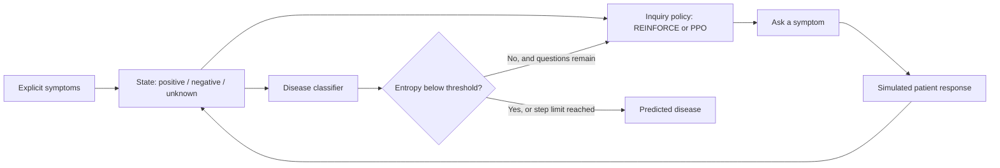
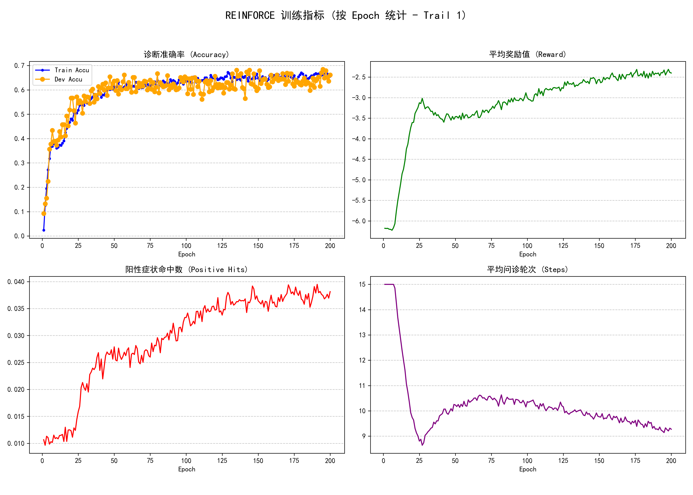
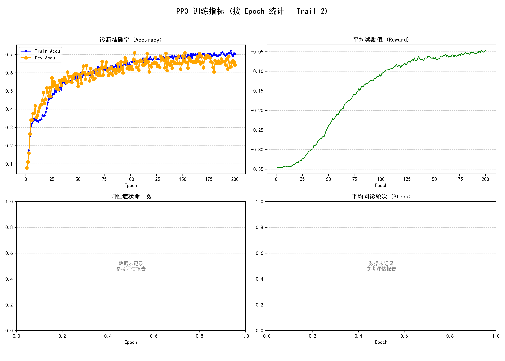

# Reinforcement Learning for Medical Dialogue

**A course project on adaptive symptom inquiry: reproduce a REINFORCE baseline, extend it with PPO, and investigate an explicit diagnosis action space.**

[中文说明](README.zh-CN.md) · [Methods and findings](docs/PROJECT_REPORT.md) · [Reproduction guide](docs/REPRODUCIBILITY.md) · [Verification](docs/VERIFICATION.md) · [Attribution](NOTICE.md)

Given a patient's initial symptoms, an agent selects follow-up questions and a classifier predicts a disease. This project explores the trade-off between diagnostic accuracy and the number of questions asked in a simulated dialogue environment.

It builds on [Yuan and Yu's public implementation](https://github.com/Yuanhy1997/Auto-Diagnosis-by-RL-and-Classification). The baseline is adapted work; the repository includes PPO and diagnosis-action experiments alongside it. This is an educational simulation, with no clinical validation.

## Project scope

- Adapt the dialogue environment to explicit and implicit symptom dictionaries, using a 118-dimensional state and 12 disease classes.
- Compare a REINFORCE inquiry policy with a PPO actor–critic extension and a separate supervised disease classifier.
- Explore 130 joint inquiry/diagnosis actions and analyze the limitations of the historical experiment.
- Preserve development-set reports and figures, and add a consistent CLI and regression checks during repository preparation.

These describe the implementation present in the project. Individual versus starter-code contributions are discussed in [the attribution notes](NOTICE.md).

## How it works



The REINFORCE implementation updates disease-specific entropy thresholds. The PPO implementation uses a **fixed threshold**; this difference matters when interpreting the comparison.

## Recorded results

These are **historical development-set results**, transcribed from the supplied reports. They were not regenerated during repository preparation; trained weights were absent.

| Variant | Development accuracy | Mean questions | Recorded symptom recall | Status |
| --- | ---: | ---: | ---: | --- |
| REINFORCE | 64.85% | 9.4393 | 0.1148 | Historical report, 239 samples |
| PPO | 66.95% | 9.1255 | 0.1260 | Historical report, 239 samples inferred from class counts |

PPO's reported accuracy is **2.10 percentage points higher**, with about **3.3% fewer questions**. This is a single recorded comparison with different stopping rules, without repeated-seed uncertainty estimates or a statistical significance test. Test labels are unavailable, so no test accuracy is claimed.

The diagnosis-action report records 7.25% accuracy over 400 processed entries. A batching defect repeatedly loaded the first batch; this report is retained as a debugging artifact and **excluded from the comparison above**. The cursor is now fixed, and this experiment requires retraining and reevaluation.

| REINFORCE training | PPO training |
| --- | --- |
|  |  |

Historical figures retain their original labels and metric definitions. See [results provenance](results/README.md) for reports and interpretation limits.

## Run locally

Python 3.11 is the repository's CI target. Use a virtual environment and install a PyTorch build suitable for your CPU or GPU, then install the direct dependencies:

```bash
python -m venv .venv
# Windows PowerShell: .venv\Scripts\Activate.ps1
# macOS / Linux: source .venv/bin/activate
python -m pip install -r requirements.txt
```

The local working copy contains the supplied dataset. Public clones require the five files described in [dataset/README.md](dataset/README.md); no verified public download source has been established for this exact split.

```bash
python scripts/inspect_data.py
python -m unittest discover -s tests -v

# Train each variant; add --device gpu to request CUDA.
python scripts/run.py reinforce train --epochs 200
python scripts/run.py ppo train --epochs 200
python scripts/run.py diagnosis train --epochs 200

# After training the corresponding model:
python scripts/run.py ppo evaluate
python scripts/run.py ppo predict
```

The legacy policy network has roughly 106 million parameters. Training needs substantial memory; use a smaller `--batch-size` if necessary. A one-epoch run is a pipeline check, not a reproduction of the historical results. Full training and checkpoint-based evaluation have not been validated in this cleanup.

## Repository layout

```text
src/                   Agents, environments, training and evaluation
scripts/               Unified launcher and local data validation
tests/                 Synthetic-data environment regression tests
docs/                  Methods, limitations and reproduction notes
results/historical/    Original aggregate development reports
assets/                Original experiment figures
dataset/README.md      Data format, split counts and access status
NOTICE.md              Upstream attribution and rights status
```

Raw datasets, generated logs, checkpoints, editor settings and student IDs are excluded from the tracked presentation. This is a project repository, suitable for later pinning on a GitHub profile.
